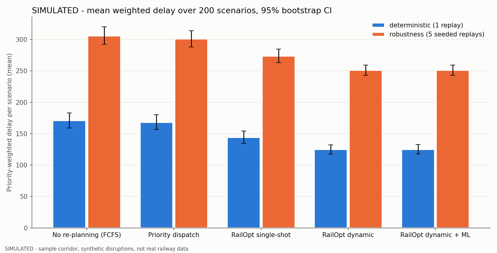
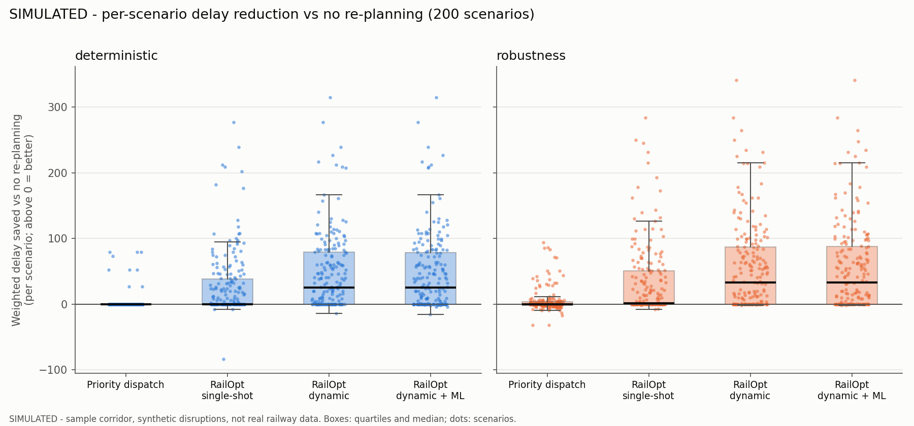

# RailOpt AI - Phase 10 evaluation (200 scenarios)

**SIMULATED - sample corridor, synthetic disruptions, not real railway data.** Every number below is generated from `eval_summary.json` (`python -m eval.run_eval`); nothing is typed by hand. These are simulator results on a sample corridor, not measurements of real railway operations. RailOpt advises a human controller; it controls no trains or signals.

## Setup

- 200 scenarios, seed 2026, timetable `full_day` (12 trains), Phase 2 generator logic (1-3 disruptions of 5-30 min + 0-5 min starting delays).
- Disruptions: 388 in total; per scenario {'1': 69, '2': 74, '3': 57}; types {'DELAY': 132, 'STOPPAGE': 126, 'TRACK_UNAVAILABLE': 130}.
- Overlap with the 3000 training scenarios (seed 42): **0** identical scenarios.
- Knowledge: stoppages and delays known at their start; closures posted 30 min before they start (or at 06:00); starting delays known from the start.
- Methods: **No re-planning (FCFS)** - first come, first served at the signals; **Priority dispatch** - the waiting train with the highest priority enters first; **RailOpt single-shot** - COMBINED CP-SAT once, when the first disruption becomes known; **RailOpt dynamic** - COMBINED re-solved whenever a new event becomes known, on top of the current plan (started trips fixed, 120-min horizon); **RailOpt dynamic + ML** - dynamic + ML risk buffers (+1 min headway on trips the conflict model flags).
- Settings: **deterministic** (one replay, no randomness) and **robustness** (5 seeded replays per scenario under the Phase 2 running-time and dwell variability, same seeds for every method, plans fixed in advance; a scenario's value is the mean of its replays).
- Statistics: mean and median with 10000-resample bootstrap 95% CIs over scenarios; paired comparisons per scenario (diff = method - reference, negative = better); a difference is significant when the CI of the mean difference excludes 0 (Wilcoxon p shown for reference).
- Every replay was checked for violations (headway, capacity, minimum running time, closures, early departures): **0 violations in 6000 replays**.
- Runtime: 180 s.

## Results - deterministic

| Method | Avg delay (min/train) | Total delay (min) | Weighted delay | Max delay (min) | Throughput (trains/h) | Trains that waited | Wait (min) |
|---|---|---|---|---|---|---|---|
| No re-planning (FCFS) | 7.56 [7.05, 8.07] median 6.96 | 90.7 [84.6, 96.8] median 83.5 | 171.0 [158.9, 183.2] median 157.5 | 26.0 [24.2, 27.7] median 25.0 | 1.66 [1.65, 1.66] median 1.67 | 3.52 [3.21, 3.82] median 3.00 | 40.1 [34.6, 45.7] median 31.0 |
| Priority dispatch | 7.53 [7.03, 8.04] median 6.96 | 90.4 [84.4, 96.4] median 83.5 | 168.4 [156.9, 180.0] median 157.5 | 27.0 [25.0, 29.1] median 25.0 | 1.66 [1.65, 1.66] median 1.67 | 3.52 [3.21, 3.82] median 3.00 | 39.8 [34.3, 45.3] median 31.0 |
| RailOpt single-shot | 6.47 [6.05, 6.89] median 5.71 | 77.6 [72.6, 82.7] median 68.5 | 144.2 [134.6, 154.3] median 127.0 | 25.2 [23.5, 26.9] median 25.0 | 1.66 [1.66, 1.67] median 1.67 | 2.46 [2.21, 2.73] median 2.00 | 24.3 [20.2, 28.8] median 9.0 |
| RailOpt dynamic | 5.60 [5.29, 5.92] median 5.17 | 67.2 [63.5, 71.0] median 62.0 | 124.8 [117.5, 132.4] median 112.0 | 23.6 [22.1, 25.1] median 24.0 | 1.67 [1.66, 1.67] median 1.67 | 1.60 [1.42, 1.78] median 1.00 | 12.2 [9.3, 15.3] median 3.0 |
| RailOpt dynamic + ML | 5.61 [5.31, 5.93] median 5.17 | 67.4 [63.7, 71.2] median 62.0 | 125.1 [117.8, 132.6] median 112.0 | 23.6 [22.1, 25.1] median 24.0 | 1.67 [1.66, 1.67] median 1.67 | 1.64 [1.45, 1.82] median 1.00 | 12.4 [9.4, 15.4] median 3.0 |

Mean [95% CI] per scenario; median below.

### Paired vs no re-planning (per scenario)

| Method | Metric | Wins / ties / losses | Mean diff [95% CI] | Median diff | Wilcoxon p | |
|---|---|---|---|---|---|---|
| Priority dispatch | Weighted delay | 9 / 191 / 0 | -2.6 [-4.5, -1.0] | 0.0 | 0.00391 | significant |
| Priority dispatch | Total delay (min) | 9 / 191 / 0 | -0.3 [-0.5, -0.1] | 0.0 | 0.00391 | significant |
| RailOpt single-shot | Weighted delay | 97 / 100 / 3 | -26.7 [-33.8, -20.4] | 0.0 | 8.33e-17 | significant |
| RailOpt single-shot | Total delay (min) | 95 / 99 / 6 | -13.1 [-16.6, -10.0] | 0.0 | 2.87e-16 | significant |
| RailOpt dynamic | Weighted delay | 132 / 67 / 1 | -46.1 [-54.2, -38.6] | -25.0 | 2.17e-23 | significant |
| RailOpt dynamic | Total delay (min) | 130 / 66 / 4 | -23.5 [-27.7, -19.7] | -14.0 | 2.34e-23 | significant |
| RailOpt dynamic + ML | Weighted delay | 132 / 60 / 8 | -45.9 [-54.0, -38.3] | -25.0 | 5.12e-24 | significant |
| RailOpt dynamic + ML | Total delay (min) | 129 / 60 / 11 | -23.4 [-27.5, -19.5] | -14.0 | 8.95e-24 | significant |

### Ablation: dynamic with vs without ML risk buffers

Weighted delay, dynamic + ML minus dynamic: wins / ties / losses 2 / 169 / 29, mean diff 0.26 [0.15, 0.37] - significant.

Dynamic minus single-shot (weighted delay): 70 / 129 / 1, mean diff -19.4 [-24.6, -14.5] - significant.

## Results - robustness

| Method | Avg delay (min/train) | Total delay (min) | Weighted delay | Max delay (min) | Throughput (trains/h) | Trains that waited | Wait (min) |
|---|---|---|---|---|---|---|---|
| No re-planning (FCFS) | 13.87 [13.28, 14.46] median 13.12 | 166.4 [159.4, 173.5] median 157.4 | 305.9 [292.2, 320.0] median 279.5 | 33.3 [31.4, 35.3] median 32.2 | 1.63 [1.62, 1.63] median 1.64 | 4.41 [4.13, 4.69] median 4.40 | 50.5 [44.1, 56.9] median 39.7 |
| Priority dispatch | 13.80 [13.23, 14.37] median 13.19 | 165.6 [158.8, 172.5] median 158.3 | 300.9 [288.2, 313.8] median 276.2 | 34.9 [32.6, 37.3] median 32.0 | 1.63 [1.62, 1.63] median 1.64 | 4.43 [4.15, 4.70] median 4.40 | 49.8 [43.7, 56.1] median 40.4 |
| RailOpt single-shot | 12.52 [12.05, 13.01] median 11.46 | 150.2 [144.6, 156.1] median 137.5 | 273.4 [262.9, 284.7] median 250.5 | 31.7 [30.0, 33.5] median 31.8 | 1.63 [1.63, 1.64] median 1.64 | 3.38 [3.14, 3.64] median 3.00 | 32.0 [27.1, 37.1] median 14.2 |
| RailOpt dynamic | 11.52 [11.18, 11.87] median 10.93 | 138.2 [134.2, 142.5] median 131.2 | 251.1 [243.2, 259.3] median 236.9 | 30.3 [28.7, 31.9] median 30.8 | 1.64 [1.64, 1.65] median 1.65 | 2.53 [2.35, 2.71] median 2.40 | 18.4 [15.0, 21.9] median 6.8 |
| RailOpt dynamic + ML | 11.52 [11.18, 11.87] median 10.93 | 138.2 [134.1, 142.5] median 131.2 | 251.0 [243.1, 259.2] median 236.9 | 30.3 [28.7, 31.9] median 30.8 | 1.64 [1.64, 1.65] median 1.65 | 2.52 [2.33, 2.70] median 2.40 | 18.3 [14.9, 21.8] median 6.8 |

Mean [95% CI] per scenario; median below.

### Paired vs no re-planning (per scenario)

| Method | Metric | Wins / ties / losses | Mean diff [95% CI] | Median diff | Wilcoxon p | |
|---|---|---|---|---|---|---|
| Priority dispatch | Weighted delay | 95 / 15 / 90 | -5.0 [-7.6, -2.7] | 0.0 | 0.0353 | significant |
| Priority dispatch | Total delay (min) | 98 / 26 / 76 | -0.8 [-1.5, -0.1] | 0.0 | 0.0175 | significant |
| RailOpt single-shot | Weighted delay | 103 / 92 / 5 | -32.5 [-40.4, -25.3] | -0.9 | 7.28e-19 | significant |
| RailOpt single-shot | Total delay (min) | 100 / 92 / 8 | -16.2 [-20.2, -12.4] | -0.1 | 7.02e-18 | significant |
| RailOpt dynamic | Weighted delay | 136 / 61 / 3 | -54.8 [-64.1, -45.9] | -32.7 | 2.13e-24 | significant |
| RailOpt dynamic | Total delay (min) | 133 / 62 / 5 | -28.2 [-33.0, -23.6] | -16.8 | 6.75e-24 | significant |
| RailOpt dynamic + ML | Weighted delay | 135 / 61 / 4 | -54.9 [-64.2, -46.0] | -32.7 | 2.28e-24 | significant |
| RailOpt dynamic + ML | Total delay (min) | 133 / 61 / 6 | -28.2 [-33.0, -23.6] | -16.8 | 5.56e-24 | significant |

### Ablation: dynamic with vs without ML risk buffers

Weighted delay, dynamic + ML minus dynamic: wins / ties / losses 4 / 183 / 13, mean diff -0.04 [-0.20, 0.10] - **not significant**.

Dynamic minus single-shot (weighted delay): 70 / 123 / 7, mean diff -22.4 [-28.5, -16.6] - significant.

## ML risk buffers - honest reading

- deterministic: weighted delay is higher (worse) with the buffers (mean diff 0.26 [0.15, 0.37]; 169 of 200 scenarios tie).
- robustness: weighted delay is not significantly different (mean diff -0.04 [-0.20, 0.10]; 183 of 200 scenarios tie).
- The model put a buffer on 1874 trips at 348 of 388 decision points; the final plan differs from plain dynamic in 40 of 200 scenarios.
- A buffer is +1 min headway; whether it helps depends on the variability it has to absorb. If the difference is not significant, the ML buffers did not help on this corridor - that is a valid result.

## Solver

| Method | Solves | OPTIMAL | FEASIBLE | other | Plans adopted | Solve time mean / p95 / max (s) |
|---|---|---|---|---|---|---|
| RailOpt single-shot | 200 | 200 | 0 | 0 | 200 | 0.013 / 0.023 / 0.030 |
| RailOpt dynamic | 388 | 388 | 0 | 0 | 388 | 0.012 / 0.022 / 0.029 |
| RailOpt dynamic + ML | 388 | 388 | 0 | 0 | 388 | 0.013 / 0.023 / 0.033 |

Solve time is wall time of one CP-SAT call including model building (1 worker, 10 s limit).

## Single-shot vs no re-planning when OPTIMAL

- OPTIMAL single-shot solves: 200.
- Worse than no re-planning on the events known at solve time (the by-construction claim): **0** 
- Worse on the full replay (later disruptions included): **3** ['V0051', 'V0116', 'V0144']
- The by-construction claim covers the events known when the solver ran. On the full replay, disruptions that become known later can make a fixed single-shot plan worse; those cases are listed, not hidden.

## Charts

## Limits

- One sample corridor (4 stations, 12 trains), synthetic disruptions and assumed variability ranges (docs/ASSUMPTIONS.md). Results say nothing about real operations.
- Robustness replays keep each plan fixed; in use, RailOpt would re-plan again as actual times drift.
- Waits include planned holds (a held train counts as waiting).
- Priority dispatch only differs from FCFS when two trains wait for the same section at the same time.
